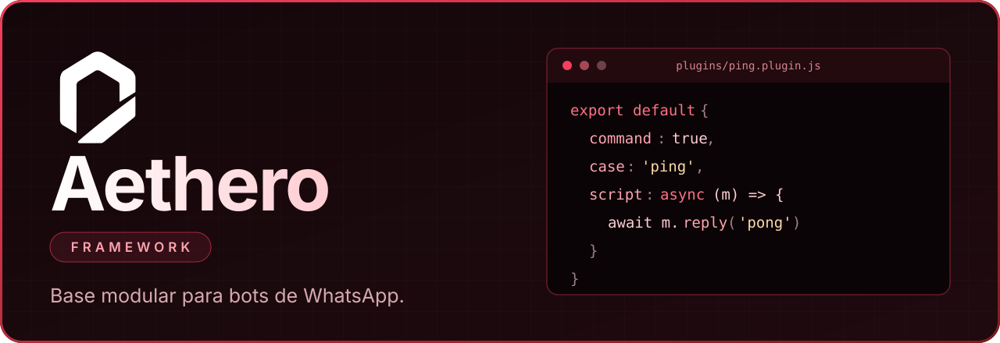
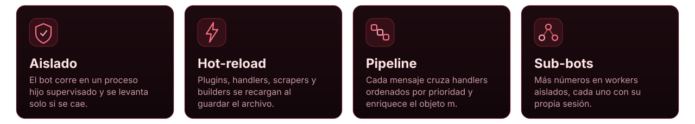
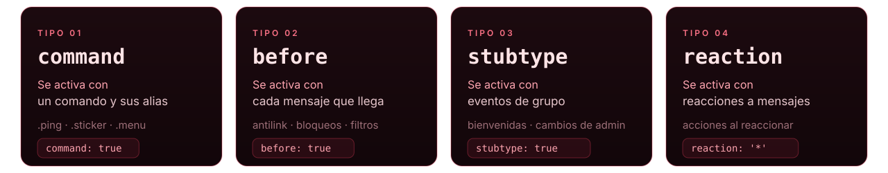
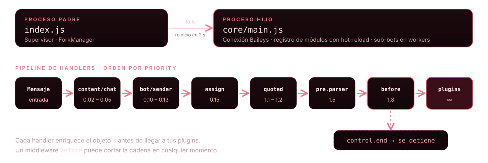
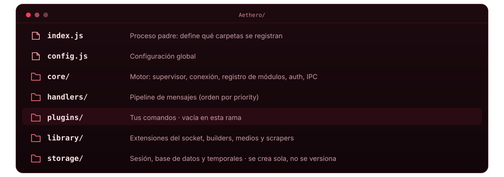

<p align="center">
  
</p>

<p align="center">
  <a href="https://github.com/Syllkom/Aethero/stargazers"></a>
  <a href="https://github.com/Syllkom/Aethero/commits/framework"></a>
  
  
  
  
</p>

<p align="center">
  <a href="#inicio-rápido">Inicio rápido</a> ·
  <a href="#tu-primer-plugin">Primer plugin</a> ·
  <a href="#cómo-funciona">Cómo funciona</a> ·
  <a href="#documentación">Documentación</a> ·
  <a href="#estructura">Estructura</a>
</p>

<p align="center">
  La <b>base limpia</b> de Aethero: el motor, el pipeline y las herramientas,<br>
  sin plugins, para que construyas tu propio bot de WhatsApp sobre <a href="https://github.com/WhiskeySockets/Baileys">Baileys</a>.
</p>

<p align="center">
  
</p>

## Inicio rápido

**Necesitas:** Node.js 22.13 o superior (usa `node:sqlite`, sin compilar nada nativo) y `git`. Para stickers y video se usa ffmpeg (se instala `ffmpeg-static` como opcional).

```bash
git clone -b framework https://github.com/Syllkom/Aethero.git
cd Aethero
npm install
npm start
```

En el primer arranque eliges vincular por **QR** o por **código de 8 dígitos**. La sesión se guarda en `storage/` y no se vuelve a pedir.

> [!NOTE]
> Funciona igual en Linux, macOS, Windows y Android con Termux (`pkg install git nodejs ffmpeg`). Ya no hace falta una rama aparte para Android.

<p align="center"></p>

## Tu primer plugin

La carpeta `plugins/` viene vacía a propósito. Crea un archivo y listo:

```js
// plugins/general/ping.plugin.js
export default {
    command: true,
    case: 'ping',
    script: async (m) => { await m.reply('pong') }
}
```

Guárdalo y escribe `.ping` en WhatsApp. No reinicies nada: el hot-reload lo detecta. Hay cuatro tipos de plugin:

<p align="center">
  
</p>

<p align="center"></p>

## Cómo funciona

<p align="center">
  
</p>

El detalle de cada paso, con sus prioridades exactas, está plegado aquí abajo.

<details>
<summary><b>Orden del pipeline</b></summary>

<br>

| Prioridad | Handler | Aporta |
|:---:|---|---|
| `0.02` | content | Contenido y tipo del mensaje |
| `0.05` | chat | Datos del chat |
| `0.10` | bot | Datos del bot |
| `0.12` | sender | Datos del remitente |
| `0.13` | reaction | Reacciones |
| `0.15` | assign | Utilidades de `m` |
| `1.1` | quoted.chat | Chat del mensaje citado |
| `1.2` | quoted.sender | Remitente del mensaje citado |
| `1.5` | pre.parser | Prefijo, comando y argumentos |
| `1.8` | before | Middlewares |
| `1.9` | stubtype | Eventos de grupo |
| `2.21` | log | Registro en consola |
| `∞` | plugins | Tus comandos |

</details>

<p align="center"></p>

## Documentación

Toda la documentación técnica está en [`docs/`](docs/README.md), escrita a partir del código y probada.

<table>
  <tr>
    <td width="33%" valign="top"><a href="docs/getting-started.md"><b>Primeros pasos</b></a><br><sub>Instalar y ejecutar por primera vez.</sub></td>
    <td width="33%" valign="top"><a href="docs/architecture.md"><b>Arquitectura</b></a><br><sub>Cómo funciona por dentro.</sub></td>
    <td width="33%" valign="top"><a href="docs/plugins.md"><b>Plugins</b></a><br><sub>Comandos, middlewares, eventos de grupo y reacciones.</sub></td>
  </tr>
  <tr>
    <td valign="top"><a href="docs/message-object.md"><b>Objeto de mensaje</b></a><br><sub>Todo lo que trae <code>m</code>.</sub></td>
    <td valign="top"><a href="docs/handlers.md"><b>Handlers</b></a><br><sub>Añadir pasos al pipeline.</sub></td>
    <td valign="top"><a href="docs/reply-flows.md"><b>Flujos de respuesta</b></a><br><sub>Esperar lo que responde un usuario.</sub></td>
  </tr>
  <tr>
    <td valign="top"><a href="docs/socket-api.md"><b>API del socket</b></a><br><sub>Enviar botones, stickers, álbumes…</sub></td>
    <td valign="top"><a href="docs/builders-reference.md"><b>Builders</b></a><br><sub>Referencia de todos los constructores.</sub></td>
    <td valign="top"><a href="docs/subbots.md"><b>Sub-bots</b></a><br><sub>Ejecutar varios números.</sub></td>
  </tr>
  <tr>
    <td valign="top"><a href="docs/configuration.md"><b>Configuración</b></a><br><sub>Opciones de <code>config.js</code>.</sub></td>
    <td valign="top"><a href="docs/storage-and-auth.md"><b>Almacenamiento y sesión</b></a><br><sub>Dónde se guardan los datos.</sub></td>
    <td valign="top"><a href="docs/troubleshooting.md"><b>Solución de problemas</b></a><br><sub>Errores comunes y cómo resolverlos.</sub></td>
  </tr>
</table>

<p align="center"></p>

## Estructura

<p align="center">
  
</p>

<p align="center"></p>

## ¿Y los plugins?

Esta rama no trae ninguno. Si prefieres un bot listo para usar:

| Rama | Qué trae |
|---|---|
| [`essentials`](https://github.com/Syllkom/Aethero/tree/essentials) | Bot ligero para producción: descargas, grupos, herramientas y moderación. |
| [`main`](https://github.com/Syllkom/Aethero/tree/main) | La experiencia completa, con RPG, gacha, juegos y más. |

<p align="center"></p>

## Créditos y licencia

**Framework:** [Syllkom (Orwyth)](https://github.com/Syllkom) · **Motor IPC:** [Zeppth](https://github.com/Zeppth), autor original de `baileys-ipc`, con el fork de Orwyth · **WhatsApp:** [Baileys](https://github.com/WhiskeySockets/Baileys)

Distribuido bajo licencia [MIT](LICENSE).

<p align="center"><sub>Hecho con 𖹭 por Orwyth</sub></p>
