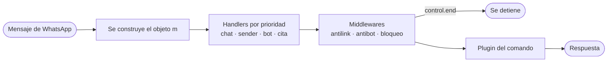

<p align="center">
  
</p>

<p align="center">
  <a href="https://github.com/Syllkom/Aethero/stargazers"></a>
  <a href="https://github.com/Syllkom/Aethero/commits/essentials"></a>
  
  
  
</p>

<p align="center">
  <a href="#inicio-rápido">Inicio rápido</a> ·
  <a href="#comandos">Comandos</a> ·
  <a href="#cómo-funciona">Cómo funciona</a> ·
  <a href="#seguridad">Seguridad</a> ·
  <a href="#documentación">Documentación</a>
</p>

<p align="center">
  La versión <b>ligera y lista para producción</b> de Aethero.<br>
  El núcleo del framework y los plugins esenciales, sin el peso de RPG, gacha ni juegos.
</p>

<table align="center">
  <tr>
    <td align="center" width="170"><h2>54</h2><sub>plugins</sub></td>
    <td align="center" width="170"><h2>6</h2><sub>categorías</sub></td>
    <td align="center" width="170"><h2>22.13+</h2><sub>Node.js</sub></td>
    <td align="center" width="170"><h2>0</h2><sub>RPG ni gacha</sub></td>
  </tr>
</table>

## Inicio rápido

**Necesitas:** Node.js 22.13 o superior, `git`, `ffmpeg` y un número de WhatsApp.

```bash
git clone -b essentials https://github.com/Syllkom/Aethero.git
cd Aethero
npm install
npm start
```

Al primer arranque eliges **QR** o **código de 8 dígitos** (número con código de país y sin `+`). Después reutiliza la sesión y ya no pregunta. Los prefijos, nombre y dueños se cambian en [`config.js`](config.js).

<details>
<summary><b>Android (Termux)</b></summary>

<br>

Instala Termux desde [F-Droid](https://f-droid.org/packages/com.termux/) y ejecuta:

```bash
pkg update -y && pkg upgrade -y
pkg install -y git nodejs ffmpeg
git clone -b essentials https://github.com/Syllkom/Aethero.git
cd Aethero && npm install
termux-wake-lock && npm start
```

</details>

<details>
<summary><b>Actualizar</b></summary>

<br>

Con el bot detenido: `git pull`, luego `npm install` (solo si cambió `package.json`) y `npm start`. Tu sesión está en `storage/`, que no se versiona.

</details>

## Essentials frente a la versión completa

| | `essentials` | [`main`](https://github.com/Syllkom/Aethero/tree/main) |
|---|:---:|:---:|
| Núcleo, hot-reload y sub-bots | ✅ | ✅ |
| Descargas (YouTube, TikTok, Instagram…) | ✅ | ✅ |
| Administración de grupos | ✅ | ✅ |
| Herramientas y stickers | ✅ | ✅ |
| Comandos de owner | ✅ | ✅ |
| Antilink, antibot y eventos de grupo | ✅ | ✅ |
| Búsquedas (anime, Bing, letras…) | — | ✅ |
| RPG y economía | — | ✅ |
| Gacha | — | ✅ |
| Juegos y comandos divertidos | — | ✅ |

## Comandos

Prefijos por defecto: `.¿?¡!#%&/,~@`. Cada categoría se despliega.

<details open>
<summary><b>Descargas</b> · 8 plugins</summary>

<br>

| Comando | Alias | Qué hace |
|---|---|---|
| `.ytmp3` | `.yta` `.audio` | Descarga el audio de un video de YouTube. |
| `.ytmp4` | `.ytv` `.video` | Descarga el video de YouTube. |
| `.play` | `.yt` | Busca y descarga música de YouTube. |
| `.tiktok` | `.tt` `.vt` | Video de TikTok sin marca de agua, o búsqueda. |
| `.instagram` | `.ig` `.reel` | Fotos, reels y carruseles. |
| `.facebook` | `.fb` `.fbdl` | Videos de Facebook en HD o SD. |
| `.spotify` | `.sp` | Canciones de Spotify. |
| `.apk` | `.appteka` | Busca y descarga aplicaciones de Appteka. |

</details>

<details>
<summary><b>Grupos</b> · 8 plugins</summary>

<br>

| Comando | Alias | Qué hace |
|---|---|---|
| `.kick` | `.expulsar` `.sacar` | Expulsa a un miembro. |
| `.promote` / `.demote` | `.daradmin` `.quitaradmin` | Da o quita el rol de administrador. |
| `.todos` | `.tagall` `.invocar` | Menciona a todos con un mensaje. |
| `.notificar` | `.hidetag` `.tag` | Notifica a todos de forma invisible. |
| `.grupo` | `.abrir` `.cerrar` | Abre o cierra la escritura del grupo. |
| `.fantasmas` | `.ghosts` `.inactivos` | Detecta inactivos y permite eliminarlos. |
| `.reglas` | `.rules` `.normas` | Muestra o configura las reglas (imagen generada). |
| `.setpp` | `.setfoto` | Cambia la foto del grupo o del bot. |

</details>

<details>
<summary><b>Herramientas</b> · 12 plugins</summary>

<br>

| Comando | Alias | Qué hace |
|---|---|---|
| `.sticker` | `.s` `.wm` `.take` | Convierte imágenes o videos en sticker. |
| `.astk` | `.audiosticker` | Sticker con audio. Cita un sticker con `.astk save` y luego un audio con `.astk`. |
| `.sreact` | `.sreaccion` | Stickers que reaccionan (`on` / `off`). |
| `.toimg` | `.toimage` | Sticker a imagen. |
| `.tomp4` | `.tovid` | Sticker a video, o une imagen o video con un audio. |
| `.tomp3` | `.toaudio` | Extrae el audio de un video. |
| `.tourl` | `.tolink` `.upload` | Sube un archivo y devuelve el enlace. |
| `.get` | `.fetch` | Obtiene el contenido de una URL (imagen, video, audio o HTML). |
| `.shazam` | `.whatmusic` `.reconocer` | Identifica la canción de un audio o video. |
| `.tr` | `.traducir` | Traduce texto. |
| `.whois` | `.stalk` | Información y foto de perfil de un usuario. |
| `.vv` | `.velda` | Revela mensajes de "ver una vez" (solo owner). |

</details>

<details>
<summary><b>Principal</b> · 9 plugins</summary>

<br>

| Comando | Alias | Qué hace |
|---|---|---|
| `.menu` | `.help` | Muestra los comandos disponibles. |
| `.ping` | `.speed` `.latencia` | Latencia y estado del bot. |
| `.info` | `.status` `.infobot` | Estadísticas: RAM, CPU y plugins cargados. |
| `.settings` | `.set` `.config` | Configuración del bot y del grupo. |
| `.subbot` | `.jadibot` `.serbot` | Crea, lista o elimina sub-bots. |
| `.invite` | `.join` | Pide unir el bot a un grupo con un enlace. |
| `.reportar` | `.report` | Envía un reporte de error a los owners. |
| `.creador` | `.creator` | Tarjeta de contacto del desarrollador. |

</details>

<details>
<summary><b>Owner</b> · 9 plugins</summary>

<br>

| Comando | Alias | Qué hace |
|---|---|---|
| `.owner` / `.deowner` | `.setowner` | Otorga o revoca el rol de owner. |
| `.ban` / `.unban` | `.banear` | Bloquea o desbloquea usuarios del bot. |
| `.botconfig` | `.bconfig` | Auto-lectura, anti-llamadas y más. |
| `.public` / `.private` | `.publico` `.privado` | Alterna entre modo público y privado. |
| `.dump` | `.json` | Muestra el JSON crudo de un mensaje. |
| `.rich` | `.airich` | Tareas progresivas en vivo con Meta AI. |
| `.dmsg` | `.delother` | Borra mensajes ajenos. ⚠️ Ver [Seguridad](#seguridad). |
| `.edit` | `.fakemsg` | Edita mensajes sin marca de "editado". ⚠️ |
| `.>` `.=>` `.$` | | Shell interactivo (JavaScript y consola). |

</details>

<details>
<summary><b>Automáticos</b> · 8 plugins, sin comando</summary>

<br>

- **Antilink:** elimina enlaces de grupos de WhatsApp (se activa por chat).
- **Antibot:** detecta y sanciona bots con una heurística de tres avisos.
- **Solo admins:** limita el uso del bot a los administradores del grupo.
- **Bloqueo por categoría:** desactiva categorías de comandos en un chat.
- **Autodescarga:** descarga los enlaces que se envían al chat (se activa por chat).
- **Bienvenida y despedida:** con imagen generada.
- **Avisos de grupo:** cambios de descripción, foto, administradores y más.

</details>

## Cómo funciona



- **Hot-reload:** guarda un plugin y se aplica al instante, sin reiniciar ni reconectar.
- **Autorreparable:** el bot corre en un proceso hijo que un supervisor vuelve a levantar si se cae. La sesión no se pierde.
- **Sub-bots:** más números en el mismo proceso, cada uno con su sesión y su base de datos.

¿Quieres crear tus propios plugins o tocar el núcleo? Mira la rama [`framework`](https://github.com/Syllkom/Aethero/tree/framework), con la documentación técnica.

## Seguridad

> [!CAUTION]
> Aethero no es un producto oficial de WhatsApp. Algunos plugins de **owner** aprovechan el protocolo de formas no oficiales, y el abuso puede acabar en el **baneo permanente** de tu número. Usa un **número secundario** y no compartas nunca la carpeta `storage/`, que contiene tu sesión.

| Comando | Riesgo | Cómo usarlo con seguridad |
|---|---|---|
| `.rich` | Editar un mensaje muchas veces por segundo activa el límite anti-spam. | Solo para pruebas cortas; no lo dejes horas con `--send`. Detenlo con `--stop`. |
| `.dmsg` / `.edit` | Forzar borrados o ediciones ajenas. Abusar de ello, por ejemplo borrar decenas de mensajes seguidos, se detecta como actividad sospechosa. | Úsalo con moderación. Sobre mensajes de otros no es fiable. |
| `.vv` | Si quien envió el mensaje tiene la confirmación de lectura, puede notar que se vio. | Úsalo con discreción. |

Detalles completos en [Advertencias de uso](docs/03-warnings.md).

## Documentación

<table>
  <tr>
    <td width="33%" valign="top"><a href="docs/01-setup.md"><b>Instalación y configuración</b></a><br><sub>Opciones de <code>config.js</code>, roles de owner y variables de entorno.</sub></td>
    <td width="33%" valign="top"><a href="docs/02-commands.md"><b>Catálogo de comandos</b></a><br><sub>El inventario completo de esta versión.</sub></td>
    <td width="33%" valign="top"><a href="docs/03-warnings.md"><b>Advertencias de uso</b></a><br><sub>Qué riesgos tiene cada plugin de owner.</sub></td>
  </tr>
</table>

## Otras ramas

[`main`](https://github.com/Syllkom/Aethero/tree/main) (experiencia completa) · [`framework`](https://github.com/Syllkom/Aethero/tree/framework) (código base sin plugins) · [`termux`](https://github.com/Syllkom/Aethero/tree/termux) (adaptación para Android)

## Créditos y licencia

**Framework:** [Syllkom (Orwyth)](https://github.com/Syllkom) · **Motor IPC:** [Zeppth](https://github.com/Zeppth), autor original de `baileys-ipc`, con el fork de Orwyth · **WhatsApp:** [Baileys](https://github.com/WhiskeySockets/Baileys)

Distribuido bajo licencia [MIT](LICENSE).

<p align="center"><sub>Hecho con 𖹭 por Orwyth</sub></p>
